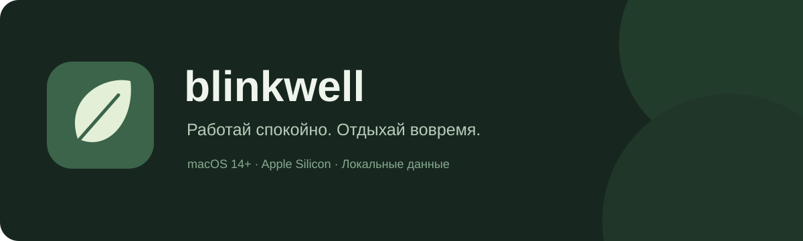

<p align="center"></p>

<p align="center">
  <a href="https://github.com/Kr1st10/Blinkwell/releases/tag/v0.5.3"></a>
  
  
  
</p>

**Blinkwell** — небольшое нативное приложение для Mac, которое напоминает отдохнуть глазам и размяться. Оно живёт в строке меню, учитывает активность и помогает подобрать удобный момент для перерыва.

Интерфейс — на русском. Это публичная тестовая сборка: приложение можно попробовать и сообщить, что мешает пользоваться им каждый день.

<p align="center">
  <a href="https://github.com/Kr1st10/Blinkwell/releases/download/v0.5.3/Blinkwell-macOS-0.5.3-arm64.dmg"><strong>Скачать для Mac · DMG</strong></a>
  &nbsp;·&nbsp;
  <a href="https://github.com/Kr1st10/Blinkwell/releases/download/v0.5.3/Blinkwell-macOS-0.5.3-arm64.zip">ZIP</a>
  &nbsp;·&nbsp;
  <a href="https://github.com/Kr1st10/Blinkwell/issues/new/choose">Сообщить об ошибке</a>
</p>

## Что умеет

| Возможность | Как работает |
|---|---|
| 👁 Отдых для глаз | По умолчанию каждые 20 минут — 20 секунд отдыха. Интервал и длительность можно изменить. |
| 🚶 Разминка | По умолчанию каждые 60 минут. Комплексы на 2, 5 или 10 минут с выбираемыми подсказками. |
| 🌿 Учёт активности | Пауза при блокировке, сне и выключении экрана. При отсутствии ввода после заданного порога время не прибавляется. |
| 📖 Чтение без мыши | Ручной режим чтения/видео на час. После простоя можно выбрать «Я читал» и вернуть пропущенное время в статистику. |
| 🔔 Постоянная карточка | Начать, отложить на пять минут активного времени или пропустить. Разминку можно свернуть в компактный таймер. |
| 🎙 Удобный момент | При использовании микрофона напоминания можно откладывать, продолжая учитывать время. Есть «Не отвлекать 30 мин» и тихие часы. |
| 📊 История дней | Итоги за выбранный день, график активности по 15 минут и список завершённых перерывов. |
| 🌙 Автоматическое возобновление | Автозапуск при входе в macOS и возобновление учёта после сна и разблокировки. |
| 🍃 Только строка меню | Опция скрытия значка из Dock и ⌘Tab. Окно и настройки открываются через листочек. |
| 🎨 Оформление | Системная, светлая и тёмная темы; управление анимациями и звуками. |

**Отсутствие ввода не означает отдых.** После возвращения Blinkwell предлагает «Я читал» / «Я отходил». Приложение не определяет взгляд, усталость или то, правильно ли выполнено упражнение.

## Установка

Требуется **Mac с Apple Silicon (M1 и новее), macOS 14 или новее**. Сборки для Intel пока нет.

1. Скачай [DMG](https://github.com/Kr1st10/Blinkwell/releases/download/v0.5.3/Blinkwell-macOS-0.5.3-arm64.dmg), открой его и перенеси **Blinkwell.app** в папку **«Программы»**. Либо распакуй ZIP и перенеси приложение вручную.
2. Открой Blinkwell. Значок листочка появится в строке меню.
3. В настройках приложения разреши уведомления, если они нужны. Включи автозапуск, если хочешь запускать Blinkwell при входе в macOS.

**Подпись пока локальная (ad hoc), нотариального подтверждения Apple нет.** Поэтому macOS может заблокировать первый запуск. Если решишь открыть именно эту сборку, следуй [официальной инструкции Apple](https://support.apple.com/102445). Отключать Gatekeeper целиком не требуется. Контрольные суммы файлов находятся в `SHA256SUMS.txt` на странице релиза.

Не запускай одновременно две копии приложения, например из «Загрузок» и «Программ».

## Первые минуты

- В «Настройки → Приложение» можно включить **«Скрывать значок в Dock»**. Переключение применяется сразу и сохраняется; следующий запуск будет только в строке меню, без автоматического открытия главного окна.
- Настрой интервалы для глаз и тела. «Отдохнуть сейчас» позволяет начать перерыв вручную.
- Закрытие окна **крестиком** оставляет таймер работающим в строке меню. **⌘Q** завершает приложение; автозапуск сработает при следующем входе, а не на простом пробуждении.
- Если читаешь или смотришь видео, включи ручной режим. Автоматического распознавания видео пока нет.
- «Не отвлекать 30 мин» откладывает напоминания, но продолжает учитывать нагрузку.
- Включённая настройка возобновления после сна/разблокировки также снимает ручную паузу. Её можно отключить.

Подробности: [руководство](docs/USAGE.md), [приватность](PRIVACY.md), [изменения](CHANGELOG.md).

## Приватность

Текущая Mac-версия работает локально: **без регистрации, аналитики и облачной синхронизации**. Она не записывает содержимое экрана, нажатые клавиши, звук или видео.

Для активности используется длительность с последнего ввода, для возможного разговора — системные флаги использования микрофона. Это не захват аудио. Определение микрофона доступно начиная с macOS 14.2 и может зависеть от системы и устройств.

Статистика и настройки остаются на Mac. Ссылка на справку открывается только по нажатию. [Подробнее о данных →](PRIVACY.md)

## Статус и ограничения

- Это **preview**, а не завершённый публичный продукт. Некоторые сценарии требуют проверки на разных Mac.
- Плавающие окна настроены для полноэкранных приложений. Поведение разных Spaces и нескольких мониторов ещё нужно проверять; пожалуйста, сообщай о переключениях рабочего стола или потерянных окнах.
- Системный баннер может исчезнуть по правилам macOS; постоянная карточка приложения управляется отдельной настройкой.
- Работа со звонками, гарнитурами, физическим сном и автозапуском после перезагрузки требует дальнейших испытаний. Использование микрофона не равно точному распознаванию звонка.
- Текущие счётчики и неразобранное уточнение простоя хранятся в памяти и сбрасываются при перезапуске; дневная статистика сохраняется.
- Донаты пока не принимаются. Персонализация карточки поддержки станет доступна после подключения проверки настоящего доната.
- Android и межустройственная синхронизация отложены и не входят в эту публичную Mac-версию.

Blinkwell предлагает общие напоминания о перерывах и не является медицинским средством. Двигайся в комфортном диапазоне; при боли прекрати упражнение.

## Сборка из исходников

Нужны Xcode с macOS SDK и Apple Silicon Mac. Приложение использует Swift Package Manager, AppKit, SwiftUI и SQLite; сторонние Swift-зависимости не подключены.

```sh
git clone https://github.com/Kr1st10/Blinkwell.git
cd Blinkwell
DEVELOPER_DIR=/Applications/Xcode.app/Contents/Developer swift test
./scripts/build-app.sh
open build/Blinkwell.app
```

Скрипт создаёт локально подписанное приложение. Он не меняет глобальный `xcode-select` и не включает автозапуск автоматически. Последняя локальная проверка — **39 тестов без ошибок**, сборка release и проверка подписи. Это не заменяет проверку реальных системных сценариев.

## Обратная связь

Нашёл проблему — [создай issue](https://github.com/Kr1st10/Blinkwell/issues/new/choose). Укажи версию приложения и macOS, модель Mac, шаги и ожидаемое поведение. Для окон особенно полезно знать, было ли другое приложение полноэкранным и сколько подключено мониторов. Не прикладывай личные данные или скриншоты с приватным содержимым.

Лицензия на исходный код пока не выбрана.
